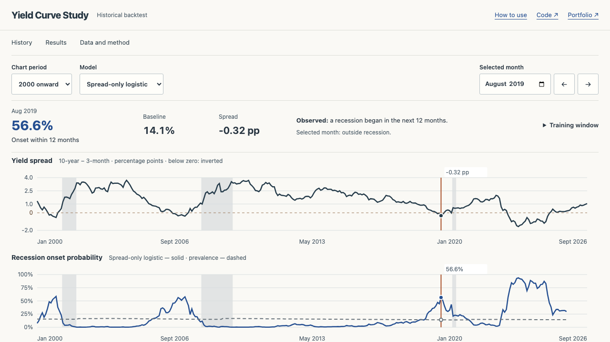

# Yield Curve Recession Study

**How informative is the yield curve about a recession beginning within the next year?**

[Historical study](https://yieldcurve.m21264551.com) · [Case study](docs/case-study.md)



## Walkthrough

Choose a historical month and compare a model with the prevalence baseline. History, Results, and Data and method remain on one continuous page. The **Period or recession** selector opens a five-year window around an onset, with the preceding month selected. Error-month buttons return to the chart without changing the model. The chart separates USREC recession shading from the forward-onset target. In **Results**, inspect false-alarm and missed months. Calibration values and the 51 annual evaluation windows are available in expandable tables. The selected-month explanation defines the prevalence baseline and its training window. **Data and method** lists units, sources, eligibility rules and limitations.

This is a saved retrospective study, not a current recession monitor. The final 12 months lack fully observed outcomes and have no evaluated forecast. Public browsing neither calls FRED nor retrains a model.

## Data

The checked-in FRED download contains monthly observations through September 2026. The overlapping yield history begins April 1953. Raw bytes, retrieval timestamp, URLs, missing values and SHA256 are preserved in `data/raw/`.

| Series | Meaning | Unit |
|---|---|---|
| [GS10](https://fred.stlouisfed.org/series/GS10) | 10-year constant-maturity Treasury, investment basis | percent |
| [TB3MS](https://fred.stlouisfed.org/series/TB3MS) | 3-month Treasury bill secondary-market rate, discount basis | percent |
| [USREC](https://fred.stlouisfed.org/series/USREC) | FRED's NBER recession indicator, peak-to-trough convention | 0/1 |

The spread is **GS10 − TB3MS in percentage points**. Its components use different quoted bases. No synthetic GDP, CPI, PMI or unemployment series are included. The previous generator is retained only under `tests/fixtures/`.

## Target and chronological evaluation

At month t, the target is a transition from USREC=0 to USREC=1 in calendar months t+1 through t+12. The current month is excluded. Missing calendar months are reindexed. Any unknown outcome in that future window makes the target unavailable. Recession-period shading uses USREC itself, not this label.

Every January, models refit on an expanding history with at least 240 eligible observations and approximately 20 years of training history. Each training target window must end **strictly before** that January. Scaling is fitted only on eligible training rows. One fixed fitted model predicts throughout the evaluation year. All public probability curves are out of sample.

Fixed initial settings:

- **Prevalence:** mean target among eligible training observations.
- **Logistic regression:** standardized spread only, C=1, maximum 1,000 iterations.
- **Gradient boosting:** spread, three-month lag/change, GS10 and TB3MS. 100 trees, depth 2, learning rate 0.03, seed 42.

No hyperparameter tuning uses the evaluation periods. Annual single-class windows explicitly leave ROC-AUC and average precision undefined. Brier remains available. Episode windows contain only positive forward-onset labels, so episode comparisons show probabilities, threshold counts and Brier rather than invented ranking metrics.

## Results

The saved study evaluates 609 months across 51 annual refits. Full-backtest metrics, episode results and calibration bins live in the exported artifact and are shown directly by the interface. The spread-only model's ROC-AUC is approximately 0.902 and Brier 0.088, versus prevalence Brier 0.109. These correlated monthly observations include only six evaluated recession onsets. They are not 609 independent economic events.

At the illustrative 50% threshold, the interface also reports misses and false alarms. The threshold was not optimized against this backtest. Strong retrospective ranking does not establish a usable current forecast.

## Architecture

`analysis/acquire.py` downloads and records a snapshot explicitly. `data_pipeline.py` constructs calendar features and labels. `model.py` enforces eligible training windows and computes out-of-sample evaluations. `export.py` writes a schema-v1 result with dataset, model settings, source checksum, code revision, every fold and every prediction.

FastAPI and the deployed static dashboard read the same artifact. `/v1/study` is the canonical API route. Existing `/overview`, `/yields`, `/model` and `/eda` routes now return the same versioned envelope. Their schema changed deliberately. The dashboard's `/api/study.json` and old static route files are generated byte-identically from that envelope. Missing artifacts return HTTP 503. There is no training on startup or synthetic fallback.

## Reproduce

Python 3.11 and Node 20:

```sh
python3 -m venv .venv
source .venv/bin/activate
pip install -r api/requirements.txt
python -m analysis.export        # reuse the recorded snapshot
python -m pytest -q
cd dashboard
npm ci
npx playwright install chromium
npm run test:browser
npm run build
npm run dev
```

To update explicitly, run `python -m analysis.acquire` before export. This downloads a new vintage and changes the data/artifact identity. `./setup.sh` and `./start.sh` provide an optional local API/dashboard shortcut. No FRED API key is required for the committed public download.

CI checks calendar targets, incomplete outcomes, the embargo, preprocessing boundaries, OOS identity, recession shading and API/static parity, then regenerates the study and builds/tests the dashboard. Browser tests exercise missing-data recovery, historical selections, metrics and desktop/mobile accessibility.

## Limitations

The downloaded vintage includes revisions and final recession classifications. It does not reconstruct the exact data releases, announcements or analyst knowledge available at each date. Monthly yield observations are treated as available at month end. Labels overlap, monetary regimes change, recession episodes are scarce, and a pandemic shock need not follow a yield-curve mechanism. The historical snapshot and backtest do not constitute a live forecast or investment recommendation.
